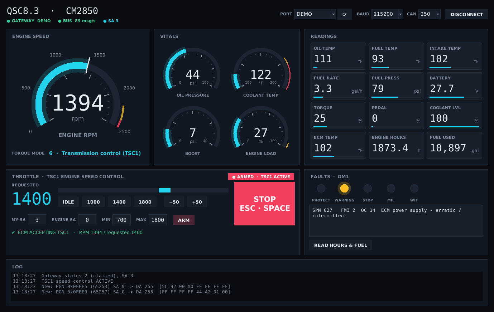

# J1939 Engine Gauge Panel With TSC1 Throttle Controls
## Control Dashboard for J1939 based Engines, connected via Standard 9-pin Diagnostics port and cable. 

Dark, digital-gauge dashboard and TSC1 throttle control for Cummins engines over SAE J1939. Works with the
[Copperhill jCOM.J1939.USB gateway](https://copperhilltech.com/sae-j1939-starter-kit-and-network-simulator/)
(SAE J1939 Starter Kit) **or any RP1210 adapter** (Cummins INLINE 6/7/8, Nexiq USB-Link, etc.). Built and tested against a **Cummins QSC8.3 / CM850 (CM2850)** on a test bench.

Single Python file, Tkinter UI. `pyserial` is the only dependency (needed only for the jCOM gateway).

> ### 🆕 RP1210 adapter support
> Use the diagnostic adapter you already have. The app now works with **RP1210 adapters**, the
> same driver standard Cummins INSITE uses, including the **Cummins INLINE 8**. Installed adapters are found
> automatically and appear in the **PORT** menu (for example `RP1210 · INLINE8, USB`), so you don't need a
> separate gateway. The live dashboard has been tested with the INLINE 8 on a CM850 bench engine. See [Requirements](#requirements) for the
> 32-bit Python note.



## Features

- **Live dashboard**
  - Engine RPM (big dial, with a marker at the requested speed while throttle is active).
  - Dials for oil pressure, coolant temp, boost and engine load, with warning and critical zones.
  - Tiles for oil, fuel and intake temps, fuel rate, fuel pressure, battery, torque, pedal, coolant level and ECM temp.
  - Engine hours and total fuel used, read on request.
- **Throttle (TSC1 engine speed control)**
  - Slider, presets and ±50 rpm buttons; arrow keys change the request by ±25.
  - Min/max RPM limits.
  - Live **Engine Torque Mode** readout, and an indicator showing whether the ECM is accepting or ignoring TSC1.
- **Faults (DM1)**: protect, amber, red stop and MIL lamps, water-in-fuel, and active codes (SPN, FMI, occurrence count) with descriptions.
- **Diagnostics log**
  - Every new PGN and source address seen on the bus.
  - Gateway version, heartbeat and serial error counters.
  - A 5-second bus health report after connecting.
- **Two adapter backends**
  - **jCOM.J1939.USB** serial gateway — cross-platform.
  - **RP1210** — Cummins INLINE 6/7/8, Nexiq, and other RP1210 adapters (Windows only). Detected automatically from the installed drivers and listed in the port menu.
- **DEMO mode**: a simulated gateway and engine, so the UI can be tried without hardware.

## Requirements

- Python 3.9+ with Tkinter (included in the standard Windows installer)
- `pyserial` (for the jCOM gateway)
- **For the jCOM gateway:** Copperhill jCOM.J1939.USB board. USB chip is a SiLabs CP2102 — Windows 10 installs the driver automatically; on Windows 11, get it from [silabs.com](https://www.silabs.com/developers/usb-to-uart-bridge-vcp-drivers).
- **For an RP1210 adapter:** the adapter's driver installed (e.g. Cummins INLINE 8 drivers — the same ones INSITE uses). The RP1210 driver DLLs are 32-bit, so **run the app with 32-bit Python** on Windows. Close INSITE first; two programs can't share one adapter.

## Install & run

```bash
pip install -r requirements.txt
python j1939_engine_panel.py
```

Behind an SSL-inspecting proxy:

```bash
pip install -r requirements.txt --trusted-host pypi.org --trusted-host files.pythonhosted.org
```

## Usage

1. Pick the adapter in the **PORT** menu: a jCOM COM port, an `RP1210 · …` entry (e.g. `RP1210 · INLINE8, USB`), or **DEMO**. Set CAN **250** kbps (CM850/CM2850). Baud **115200** applies to the jCOM gateway only.
2. Click **CONNECT**. The adapter starts in listen-only mode and the dashboard fills in.
3. **Throttle:** with the engine running, set **My SA** (default `3`), **Engine SA** (`0`) and min/max RPM, then **ARM**.
   - The app claims the address and the gateway sends TSC1 every 10 ms.
   - Move the slider and watch the response line and the torque mode.
4. **READ HOURS & FUEL** claims an address and requests engine hours and total fuel used every 5 s.

If the ECM ignores TSC1, try another source address (for example 39 / 0x27, 17 / 0x11, or 230 / 0xE6). Some calibrations only accept TSC1 from specific addresses.

## ⚠️ Safety

- **jCOM gateway:** while ARMED the gateway repeats TSC1 on its own. If the PC or app crashes, the engine **holds the last requested speed** until you cut it off.
- **RP1210 adapter:** the app itself repeats TSC1, gated by a heartbeat from the running UI. If the app freezes or crashes, TSC1 stops within ~0.5 s and the ECM releases the override after its timeout, which is a safer failure mode than the jCOM. The fail-safe **latches off**: the throttle won't come back on its own, so you must ARM again.
  - On Windows, dragging or resizing the window pauses the UI, so it trips this fail-safe. Don't move the window while armed.
- Kill switch either way: **STOP / Esc / Space**, **unplug the adapter**, or **key off**.
- Built-in watchdogs drop the override:
  - if RPM data is lost for 1.5 s;
  - on overspeed (max RPM + 300).
- ARM is refused unless the engine is running (above 400 rpm).
- Test on a bench or with the machine in neutral and parked. Keep max RPM conservative.
## Tested/Supported Models
If anyone tests another model of engine, please open a Github issue, and I will update status here.

Currently tested on:
  - Cummins 8.3 CM2850 CP3 Fuel Pump
  - Cummins 8.9 

**In theory this should work on any engine that communicates over J1939 CAN bus, but use caution when trying. I assume no responsibility for any issues and mechanical or bodily harm caused by using this software.**

## Troubleshooting

| Symptom | Likely cause |
|---|---|
| `GATEWAY OK` but `BUS 0 msg/s` | Key off; CAN-H/CAN-L swapped; termination wrong (aim for ~60 Ω between CAN-H and CAN-L with power off) |
| No gateway ACKs | Old ACK setting stored in the gateway. Connect now forces ACKs back on |
| Wrong CAN speed | CM850/CM2850 = 250 kbps. Some newer engines use 500 kbps |
| ECM ignores TSC1 | TSC1 not allowed from that source address in the calibration. Try other SAs |
| RP1210: `Could not load ….dll` | Driver DLLs are 32-bit. Run the app with 32-bit Python |
| RP1210: connect fails or `GATEWAY RP1210 (no data)` | Close INSITE or any other program using the adapter. Check the adapter is plugged in and the driver is installed |
| RP1210 adapter missing from the PORT menu | Install its driver, then click ⟳. Adapters are read from `C:\Windows\RP121032.ini` |

## How it works

- **Adapter backends:** both present the same internal message interface, so the dashboard, faults and throttle logic are shared.
  - **jCOM:** the documented serial protocol ([PDF](https://copperhilltech.com/content/jCOM1939-Protocol.pdf)) — byte-stuffed frames starting with `0xC0` and a 2's-complement checksum. Commands used: RESET, ADDFILTER, SETPARAM1 (address claim), TXDATA / TXDATAP (periodic transmit), REQINFO.
  - **RP1210:** the standard `RP1210_*` C API via `ctypes`. Adapters are discovered from `RP121032.ini` and each vendor `.ini`. Connects with `J1939:Baud=…`, passes all filters, claims the address with the Protect-J1939-Address command, and sends/reads J1939 messages. TSC1 is repeated from a worker thread gated by a UI heartbeat.
- **J1939 data:** decoded per SAE J1939-71.
  - Parameter groups: EEC1/2, ET1/2, EFL/P1, LFE, IC1, VEP1, HOURS, LFC, WFI.
  - Fault codes: DM1 (J1939-73).

## License

[GNU General Public License v3.0 or later](LICENSE). You may use, modify and redistribute this software, but any
distributed modified version must also be released under the GPL with its source code.
